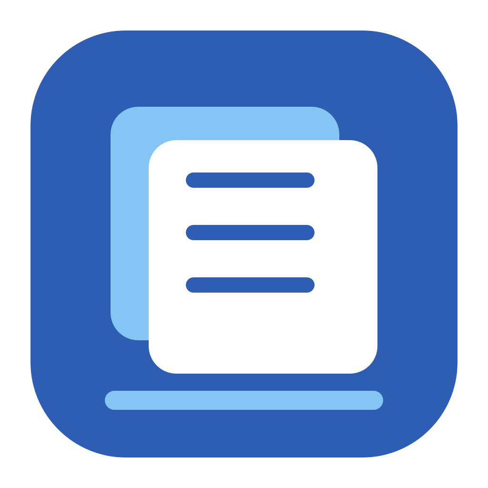

<p align="center"></p>

# CopyShelf

**Your last 100 copies, a shortcut away.**

  

A small native macOS clipboard manager. Copy several things, open your history beside the mouse pointer, and paste the one you need.

- Up to 100 distinct recent copies, grouped by tens.
- Selecting a copy moves it to the top.
- Text pastes as plain text, with rich-text and HTML formatting removed.
- Text, rich text, links, images, PDFs, and file references.
- Local history survives restarts.
- Menu bar app with optional launch at login.

## A familiar workflow

Copy a link, a paragraph, and an image. Press **⌘⇧V**, choose what you need, and press **Return**. That copy moves to the front of your history, ready to use again.

New copies push older ones down through groups **1–10**, **11–20**, all the way to **91–100**. Once the history is full, the oldest copy makes room for the next.

## Install

Download the latest **CopyShelf DMG** from [Releases](https://github.com/RoySadaka/CopyShelf/releases/latest), open it, and drag CopyShelf into **Applications**. The app supports Intel and Apple silicon Macs running macOS 13 or later.

This community build is locally signed and **not notarized by Apple**. macOS may block the first launch. If you trust this release, use **System Settings → Privacy & Security → Open Anyway**.

## Versions and updates

Choose **About CopyShelf** in the menu to see your version. **Check for Updates…** checks the latest public GitHub release and offers its download page when a newer version exists. Quit CopyShelf before replacing it in Applications, then reopen it. Your history stays in Application Support.

## Build from source

Requires macOS 13 or later and Apple's Command Line Tools. Install the tools with `xcode-select --install`, then run from this repository:

```sh
./test.sh
./build.sh
cp -R build/CopyShelf.app /Applications/
open /Applications/CopyShelf.app
```

Quit an existing CopyShelf instance before replacing it. Builds include Intel and Apple silicon binaries and are signed locally. Developer ID signing and notarization are outside the current build script.

Enable CopyShelf in **System Settings → Privacy & Security → Accessibility** for automatic paste. Restart CopyShelf after changing permission. Rebuilding may require removing and adding the app again in Accessibility.

## Use

Copy normally with **⌘C**. Open history with **⌘⇧V** or **⌃⌘V**. The menu appears at the mouse pointer with the first group expanded.

| Key | Action |
| --- | --- |
| ↑ / ↓ | Move through items |
| → / ← | Enter or leave a group |
| Return | Select and paste |
| 1–9, 0 | Select an item in the current group |
| Escape | Close the menu |

The menu bar icon also opens history and offers **Clear History**, **Open at Login**, and **Quit**. Without Accessibility permission, selection restores the clipboard and you can paste using **⌘V**.

If Finder Quick Look copies empty text while previewing an image, CopyShelf uses Accessibility to match the preview to the selected file. It puts the recovered image on the system clipboard so you can paste it with **⌘V** or choose it later from history.

## Storage and limits

History is stored in `~/Library/Application Support/CopyShelf/history.plist`. Clipboard contents stay on your Mac. The app contacts GitHub only when you choose Check for Updates. Clipboard contents are never included in that request. There are no third-party dependencies.

History is unencrypted and may contain sensitive copied text. Items marked concealed, transient, or autogenerated by their source app are skipped. Other copied secrets can enter history.

The app keeps at most 100 items within a 64 MiB history budget and skips individual copies over 20 MiB. File copies store references to the original files. Clipboard changes are checked every 250 ms, so very rapid successive copies can be missed.

## Contributing

Small fixes and focused improvements are welcome. Describe reproduction steps for bugs and explain behavior changes in pull requests. Run `./test.sh` and `./build.sh`, then check the menu and pasting in a native text editor. Use sample clipboard contents for screenshots and bug reports.

The implementation uses Swift and AppKit. `scripts/icon.swift` regenerates the original icon with `swift scripts/icon.swift`. Source code and icon assets are covered by the [MIT license](LICENSE).

## Create a release

Run `./release.sh` to test, build a universal app, and produce a DMG plus SHA-256 checksum in `build/`. Set the version and build number in `Info.plist` before a release. Publish a matching `vX.Y.Z` GitHub release with these files so the update check can find it.
